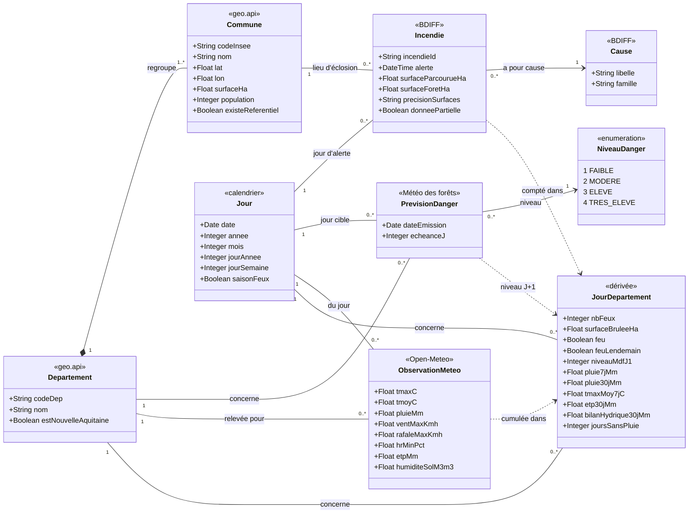
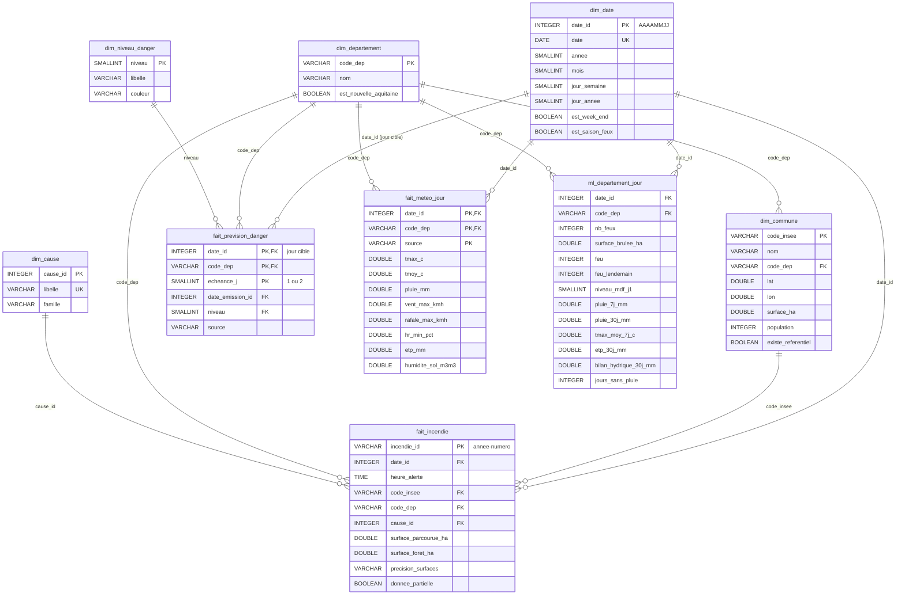

# 4. Modèle de la base de données (UML)

Le modèle est construit **à partir des données que l'on va exploiter**, et seulement d'elles. Chaque classe est alimentée par une des 4 sources retenues (indiquée en stéréotype). Chaque attribut correspond à un champ source précis et sert au moins une question atomique, ou un contrôle de qualité.

Deux niveaux :
1. **Diagramme de classes UML (conceptuel)** : les objets et leurs associations, indépendamment de la technique.
2. **Modèle physique gold (relationnel)** : le schéma en étoile créé par [`sql/gold_schema.sql`](../../sql/gold_schema.sql) et testé sur les données réelles.

## 4.0 Traçabilité : sources → modèle

| # | Source | Rôle | Fichier produit | Classe(s) UML | Table(s) gold |
|---|---|---|---|---|---|
| 1 | BDIFF | Cible | `data/incendies.csv` | `Incendie`, `Cause` | `fait_incendie`, `dim_cause` |
| 2 | Météo des forêts | Indice à évaluer | `data/meteo_foret_na.csv` | `PrevisionDanger`, `NiveauDanger` | `fait_prevision_danger`, `dim_niveau_danger` |
| 3 | geo.api.gouv.fr | Référentiel | `data/communes_na.csv` | `Commune`, `Departement` | `dim_commune`, `dim_departement` |
| 4 | Open-Meteo (ERA5) | Variables explicatives | `data/meteo_quotidienne/<dep>.csv` | `ObservationMeteo` | `fait_meteo_jour` |
| — | Calendrier (dérivé) | Axe temporel | — | `Jour` | `dim_date` |
| — | Dérivée des sources 1, 2, 4 | Apprentissage | `data/dataset_modele.csv` | `JourDepartement` | `ml_departement_jour` |

## 4.1 Diagramme de classes UML (conceptuel)

*Export image : [img/uml-classes.png](img/uml-classes.png)*

**Lecture du diagramme**
- **Les stéréotypes** (`«BDIFF»`, `«Open-Meteo»`…) indiquent la source qui alimente chaque classe. `«calendrier»` est une dimension générée ; `«dérivée»` est calculée à partir des autres classes.
- **Les jours sans feu sont représentés** : une commune peut n'avoir aucun incendie (`0..*`), et `JourDepartement` contient une ligne par département et par jour. C'est indispensable pour mesurer les fausses alertes de l'indice et pour entraîner un modèle.
- **Un feu a une seule commune d'éclosion et un seul jour d'alerte**, même s'il dure plusieurs jours.
- **La prévision de danger** est portée par un département, un jour cible et une échéance (J+1 ou J+2). Elle garde sa date d'émission pour qu'un feu soit comparé au niveau **annoncé la veille**.
- **Les flèches pointillées** (dépendances) montrent ce qui est agrégé dans `JourDepartement` : les feux (cible), la météo (cumuls et sécheresse) et le niveau annoncé la veille (référence).

## 4.2 Attributs exploités et justification

| Classe | Attribut | Champ source | Sert à |
|---|---|---|---|
| Departement | codeDep, nom, estNouvelleAquitaine | BDIFF `Département` ; MdF `nom_dep` | Jointures ; filtre région ; TER-2 (France) |
| Commune | codeInsee, nom, lat, lon | geo.api `code_insee`, `commune`, `lat`, `lon` | LOC-1 à LOC-3 ; point météo du département |
| Commune | surfaceHa | geo.api `surface_ha` | LOC-4 (départs rapportés à la surface) |
| Commune | population | geo.api `population` | Contexte des communes prioritaires (LOC) |
| Commune | existeReferentiel | dérivé | Signale les 137 feux sur communes fusionnées |
| Jour | date, annee, mois, jourAnnee, jourSemaine, saisonFeux | calendrier | TEMP-1, TEMP-3, TEMP-4 ; IND-6 (hors saison) |
| Incendie | incendieId | BDIFF `Année` + `Numéro` | Identifiant |
| Incendie | alerte | BDIFF `Date de première alerte` | Jour (toutes les questions) ; TEMP-2 (heure) |
| Incendie | surfaceParcourueHa | BDIFF `Surface parcourue (m2)` | LOC-2, AMP-1, AMP-2, TER-2 |
| Incendie | surfaceForetHa | BDIFF `Surface forêt (m2)` | AMP-1 (part forestière de la surface brûlée) |
| Incendie | precisionSurfaces, donneePartielle | BDIFF `Précision des surfaces`, `Précision de la donnée` | Filtres de qualité (section 8 du rapport) |
| Cause | libelle, famille | BDIFF `Nature` | CAU-1 |
| PrevisionDanger | dateEmission, echeanceJ, niveau | MdF `date`, `niveau_j1`, `niveau_j2` | IND-1 à IND-6, TER-1, TER-3 |
| ObservationMeteo | les 8 variables | Open-Meteo | MET-1 à MET-4, AMP-2 ; variables du modèle |
| JourDepartement | cibles et indicateurs | dérivés | Modèle de prédiction J+1 |

**Ce qui a été retiré** parce que rien ne l'exploite :
- **Classes de décision** (`CentreSecours`, `DispositifRenforce`, `SeuilDeclenchement`) : aucune source ne les alimente. Elles reviendront quand le SDIS aura fourni ses données internes.
- **Détection satellite (NASA FIRMS)** : abandonnée par le groupe. La classe `DetectionSatellite`, la table `fait_detection_satellite` et les questions DET ne font plus partie du modèle.
- **`Region`** : une seule région, réduite à l'attribut `estNouvelleAquitaine`.
- **`Peuplement`, surface maquis-garrigues** : champs vides en Nouvelle-Aquitaine (0 %).
- **Surfaces par catégorie** (autres surfaces naturelles, agricoles) **et dégâts** (décès, bâtiments) : aucune question ne les utilise. Les dégâts sont aussi des données sensibles, qu'il vaut mieux ne pas diffuser (minimisation). Ces champs restent nettoyés et harmonisés dans la couche **silver**, disponibles si une question future en a besoin.

## 4.3 Modèle physique gold (schéma en étoile)

*Export image : [img/schema-etoile-gold.png](img/schema-etoile-gold.png)*

### Grain de chaque table de faits

| Table | Une ligne = | Mesures | Questions servies |
|---|---|---|---|
| `fait_incendie` | un feu (fiche BDIFF) | surface parcourue, surface forestière | LOC, TEMP, AMP, CAU, TER-2 |
| `fait_prevision_danger` | un département × un jour cible × une échéance | niveau 1 à 4 | IND, TER-1, TER-3 |
| `fait_meteo_jour` | un département × un jour | 8 variables météo | MET, AMP-2 |
| `ml_departement_jour` | un département × un jour (table de travail) | cibles et indicateurs dérivés | modèle de prédiction |

### Table de features `gold.ml_departement_jour`
Elle reprend **exactement les variables du tableau `modele` du notebook**, avec une ligne par département et par jour pour les 12 départements de 2006 à 2025 (87 660 lignes), jours sans feu compris. Elle contient aussi les colonnes météo du jour, non détaillées dans le diagramme. La dernière cellule du notebook compare les deux tables colonne par colonne : l'écart est nul (aux arrondis près) et les valeurs manquantes tombent sur les mêmes lignes.

| Notebook (`modele`) | Gold (`ml_departement_jour`) |
|---|---|
| `nb_feux`, `surface_brulee_ha`, `feu` | `nb_feux`, `surface_brulee_ha`, `feu` |
| `feu_lendemain` | `feu_lendemain` (cible J+1) |
| `pluie_7j`, `pluie_30j` | `pluie_7j_mm`, `pluie_30j_mm` |
| `tmax_moy_7j` | `tmax_moy_7j_c` |
| `et0_cumul_30j` | `etp_30j_mm` |
| `bilan_hydrique_30j` | `bilan_hydrique_30j_mm` |
| `jours_sans_pluie` | `jours_sans_pluie` |
| `niveau_danger` | `niveau_mdf_j1` |
| `mois`, `jour_annee`, `jour_semaine` (0 = lundi) | `mois`, `jour_annee`, `jour_semaine` (0 = lundi ; `dim_date` reste en norme ISO, 1 = lundi) |

### Choix de modélisation
- **Gold minimal, silver complet** : la couche gold ne garde que les attributs exploités. Les autres champs nettoyés (surfaces par catégorie, dégâts, peuplement) restent en silver, prêts si une question future en a besoin.
- **Étoile plutôt que flocon** : les dimensions sont petites. On accepte la redondance de `code_dep` dans `fait_incendie` pour éviter une jointure dans toutes les requêtes départementales.
- **Clé de date entière `AAAAMMJJ`** : elle est lisible, triable et commune à toutes les tables de faits.
- **Prévision séparée de l'observation** : `fait_prevision_danger` garde l'échéance et la date d'émission, pour ne jamais comparer un feu à un niveau publié après coup.
- **Gestion des communes fusionnées** : l'ancien code est conservé avec un drapeau. On pourra passer à une dimension historisée avec la table de passage INSEE.
